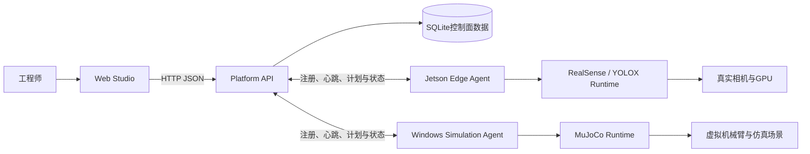

# 系统架构

当前系统基线见[机器人开发平台当前基线](current-platform-baseline.md)。本文只描述稳定的系统结构，不记录阶段进度。

## 总体结构

平台采用一个控制面、多个执行节点。Web Studio不直接连接Agent或硬件；所有控制意图先进入Platform API。相机帧、深度图、张量和仿真步进留在目标节点本地，控制面只接收状态、轻量指标与低频预览。

## 组件职责

### Web Studio

- 浏览Catalog、项目、节点、制品和运行记录；
- 在类型化画布上编辑工作流；
- 显示部署预检，发起制品准备、启动、停止和回退；
- 不拥有最终兼容性或安全裁决权。

### Platform API

- 从Manifest构建只读Catalog；
- 保存项目、不可变工作流修订、DeploymentPlan和安装事务；
- 校验画布结构并匹配已登记的可执行配方；
- 按目标Agent解析逻辑制品的平台变体；
- 协调部署状态和互斥资源切换；
- 不运行机器人数据面。

### Edge Agent

- 主动注册并持续上报节点能力、设备与制品库存；
- 拉取不可变计划并进行第二次白名单校验；
- 采用有限安装策略管理本机制品；
- 启停受管Runtime，保持状态、预览与安全停止；
- 不把Manifest解释为通用脚本。

### Runtime与硬件适配器

- 轻量适配插件负责发现、身份解析和生命周期接口；
- 重型SDK、GPU框架和高频处理进入隔离Runtime；
- Runtime实现经过验证的组件拓扑，不执行任意画布；
- 真实运动必须由本地安全门和独立控制器约束。

## 控制面与数据面

| 数据 | 路径 | 持久化 |
|---|---|---|
| 项目、修订、计划、安装事务 | Studio ↔ API | SQLite |
| Agent身份、能力、库存 | Agent → API | 最新状态，易失 |
| 部署期望状态 | API ↔ Agent | SQLite记录 + Agent执行 |
| 指标、低频预览 | Runtime → Agent → API → Studio | 易失 |
| 视频、深度、张量、控制周期数据 | Runtime本地 | 不进入Platform API |

## 部署编译边界

画布通过端口校验只说明数据结构可连接。部署还必须依次满足：

1. 节点集合与连接匹配一个`WorkflowRecipe`；
2. 目标Agent具备配方要求的能力；
3. 每个逻辑制品解析出唯一兼容变体；
4. 本机库存的版本与摘要匹配，或存在允许的准备策略；
5. Platform API生成不可变DeploymentPlan；
6. Edge Agent复核拓扑、制品、路径、设备和安全参数。

这两层校验不能被Studio中的按钮状态替代。

## 当前部署拓扑

### 开发与仿真

- Windows：Web Studio、Platform API、SQLite、MuJoCo Simulation Agent；
- Jetson：systemd Edge Agent、RealSense插件、TensorRT Engine和融合容器Runtime；
- Tailscale或可信局域网只承载控制面通信；原始视频不跨节点传输。

### 未来现场部署

Platform API和Studio可以迁移到Linux服务器或机器人本机，但领域协议、Manifest和DeploymentPlan保持一致。真实机械臂或底盘接入时，确定性闭环、急停、限位和联锁必须留在MCU、PLC或专用控制器，不能迁移到Web控制面。

## 安全原则

- 默认拒绝未知拓扑、未知制品、未知摘要和不兼容平台；
- 制品安装必须可校验并在失败时保留或恢复上一激活版本；
- Runtime按最小设备权限运行，真实容器不开网络且不使用常规`--privileged`；
- 停止与安全停止始终优先，不能依赖当前Catalog仍然完整；
- 当前机械臂链路只输出到MuJoCo，真实运动输出保持关闭。
