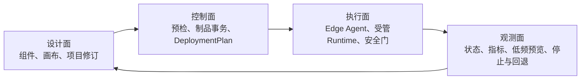
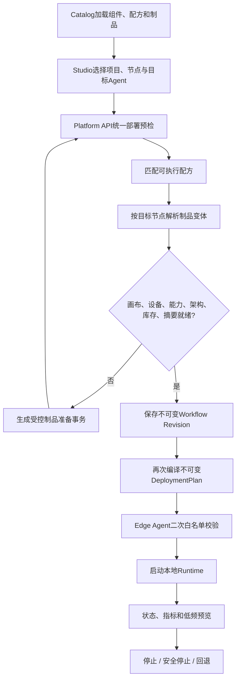

# 机器人开发平台当前基线

本文是当前实现的权威总览。发生冲突时，当前代码、Manifest、ADR和本文依次优先于早期里程碑记录。

## 1. 当前目标

平台解决的是机器人软件的工程化交付问题：把硬件、算法、仿真、标定和运行环境描述为可验证资产，在Web中形成不可变工作流修订，再把固定版本与摘要的DeploymentPlan下发到合适的Edge节点执行。

当前阶段只开放三类执行结果：

- Jetson上的RealSense到YOLOX感知链路；
- Windows上的模拟RGB-D到MuJoCo机械臂仿真链路；
- Windows真实摄像头与YOLOX驱动MuJoCo机械臂的仿真闭环。

真实机械臂、移动底盘和ROS 2运动输出尚未开放。新增功能前先保持本基线稳定。

## 2. 四个平面

| 平面 | 主要归属 | 允许做什么 | 不允许做什么 |
|---|---|---|---|
| 设计面 | Web Studio + Catalog | 选组件、连端口、编辑参数、保存修订 | 直接访问硬件、执行任意代码 |
| 控制面 | Platform API | 校验、解析变体、准备制品、生成计划、持久化状态 | 传输原始视频或承担实时控制 |
| 执行面 | Edge Agent + Runtime | 复核计划、安装受控制品、运行本地数据流 | 执行Manifest中的任意Shell命令 |
| 观测面 | Agent + API + Studio | 上报低频状态、指标、预览，停止和回退 | 把高频数据写入控制面数据库 |

## 3. 三个长期稳定的进程角色

### Web Studio

- 只调用Platform API；
- 提供项目、组件、制品、工作流、运行记录和节点视图；
- 前端的预检提示用于交互，Platform API与Edge Agent仍必须独立复核。

### Platform API

- 启动时扫描Manifest，生成只读Catalog快照；
- 用SQLite保存项目、不可变修订、部署记录和制品安装事务；
- Agent在线状态、最新指标和预览保持易失；
- 根据目标节点的系统、架构、能力和元数据解析唯一制品变体；
- 编译不可变DeploymentPlan，不发送任意命令字符串。

### Edge Agent

- 运行在Jetson、工控机或Windows仿真机；
- 主动注册、心跳、盘点设备与制品；
- 执行有限的安装策略和白名单Runtime；
- 在本机再次核对组件拓扑、制品版本、摘要、路径和设备占用；
- 控制面短暂断线时维持已授权Runtime运行。

## 4. 核心领域对象

| 对象 | 含义 | 是否可变 | 权威来源 |
|---|---|---:|---|
| Component Definition | 硬件或算法的端口与参数Schema | 随包版本变化 | 硬件/算法Manifest |
| Artifact Definition | 可分发文件及平台变体 | 随制品版本变化 | artifact/package Manifest |
| Workflow Recipe | 已实现且允许部署的固定拓扑 | 随Runtime版本变化 | workflow-runtime Manifest |
| Workflow Revision | 项目中的一次设计快照 | 否 | SQLite |
| DeploymentPlan | 修订、目标节点和制品摘要的运行快照 | 否 | SQLite |
| Artifact Installation | 一次受控制品准备事务 | 状态可迁移 | SQLite + Agent回报 |
| Agent Record | 节点身份、能力、设备和库存 | 是 | Agent心跳 |
| Runtime Snapshot | 状态、指标和低频预览 | 是、易失 | Edge Runtime |

必须区分以下概念：

- 组件是逻辑能力，不等于安装文件；
- 制品是可验证的交付物，不等于画布节点；
- 配方证明某个拓扑有执行后端，端口连通不等于可执行；
- 修订保存设计历史，DeploymentPlan保存一次实际运行所用的完整快照；
- 仿真资产、标定配置、Runtime包和容器镜像都属于制品，但安装策略不同。

## 5. 唯一主流程

任何新功能都必须进入这条主流程，不能另建旁路启动方式。

Studio中的预检结果绑定当前画布内容、运行参数、目标节点、设备清单和制品库存。任何影响执行语义的变化都会使旧结果失效并要求重新检查；单纯移动画布节点不影响执行语义。保存修订始终独立于部署，允许保留尚未具备Runtime配方的设计草稿。

## 6. 当前已验证运行族

### RealSense → YOLOX

- 目标：Jetson AGX Orin / Linux ARM64；
- 节点：RealSense相机、YOLOX检测器；
- 执行：融合Docker Runtime；
- 制品：RealSense发现插件、融合Runtime镜像、TensorRT Engine；
- 输出：检测指标与低频JPEG预览；
- 安全：只感知，不产生运动命令。

### 模拟RGB-D → 空间定位 → 规划 → Safety Gate → MuJoCo机械臂

- 目标：当前为Windows AMD64仿真节点；
- 节点：模拟相机、模拟检测、RGB-D定位、笛卡尔规划、安全门、MuJoCo机械臂；
- 执行：受管Python Runtime Package；
- 制品：MuJoCo Runtime和相机到机械臂标定配置；
- 输出：目标位姿、运动状态、PNG预览；
- 安全：`robot_motion_output=false`，只允许仿真运动。

工作流0.3.0使用独立标定制品。历史0.2.0修订仍可读取其不可变参数快照，用于真实回退；新修订不得继续内嵌标定数值。

### Windows摄像头 → YOLOX ONNX → Safety Gate → MuJoCo机械臂

- 目标：Windows AMD64仿真节点；
- 节点：Windows USB摄像头、YOLOX ONNX检测器、检测框仿真映射、安全门、MuJoCo机械臂；
- 执行：摄像头插件、Windows视觉Runtime Package和MuJoCo Runtime Package；
- 输出：手机检测、受限仿真目标、运动与安全指标、双画面JPEG预览；
- 安全：真实摄像头只作为输入，二维到三维映射不属于真实标定，运动只允许进入MuJoCo。

## 7. 部署位置与制品变体

逻辑制品只有一个`artifact_id + version`，无法跨平台复用的文件通过`variants`表达。部署位置不是写死在Studio里的按钮逻辑，而由以下条件共同决定：

1. 工作流配方要求的能力；
2. Agent上报的操作系统与CPU架构；
3. 制品变体兼容条件；
4. 节点本地库存、版本与摘要；
5. Runtime自身的设备和安全白名单。

架构别名统一归一化：`AMD64/x64/x86_64 → x86_64`，`ARM64/aarch64 → aarch64`。

当前推荐拓扑：

| 部分 | 运行位置 | 原因 |
|---|---|---|
| Studio + Platform API | Windows开发机 | 便于开发、持久化和远程控制 |
| MuJoCo Simulation Agent | Windows开发机 | 已验证的AMD64仿真环境与可视化能力 |
| RealSense/YOLOX Agent | Jetson | 摄像头、CUDA、TensorRT与低延迟数据面在本机 |
| 真实运动控制器 | 尚未接入 | 必须先完成硬件在环与独立安全验收 |

## 8. 不可破坏的工程约束

1. Studio不直连硬件，Platform API不承载高频数据面。
2. 任意画布可以保存；只有匹配已登记配方的画布可以部署。
3. 修订、DeploymentPlan、制品版本和摘要不可原地修改。
4. 安装只使用有限策略：镜像拉取/导入、wheel、受管文件、受管配置；不执行任意Shell。
5. Platform API和Edge Agent都要校验，不信任前端状态。
6. 停止操作不能因制品缺失或摘要变化而被阻断。
7. 占用同一硬件的版本切换必须先停止旧Runtime，再启动新计划。
8. 运动命令必须经过本地Safety Gate；网络、Web和普通Agent不承担确定性安全闭环。
9. 未完成硬件在环验收的执行器只能输出到仿真。
10. 新资产不得在核心服务中增加厂商分支，必须通过Manifest、插件或Runtime包接入。

## 9. 当前版本基线

| 模块 | 版本/Schema |
|---|---|
| Platform API | 0.29.0 |
| Edge Agent | 0.21.0 |
| SQLite Schema | 3 |
| RealSense→YOLOX配方 | 0.1.1 |
| MuJoCo空间工作流配方 | 0.3.0 |
| Windows摄像头闭环工作流配方 | 0.1.5 |
| MuJoCo Runtime Package | 0.4.0 |
| Windows摄像头YOLOX Runtime Package | 0.2.0 |
| 标定配置Schema | `robot.calibration.camera-to-arm.v1` |

## 10. 已知且受控的框架债务

以下问题不阻止当前基线验收，但必须在扩展大量资产前处理或保持显式边界：

- `catalog.py`中的模拟相机、模拟算法和基础模拟配方仍是Bootstrap/Test Fixture；新增业务资产不得继续照此硬编码，后续应迁移为Manifest包；
- Studio制品页和工作流页已经共享Platform API的目标节点变体解析结果；本地库存比较仍只用于即时展示，最终结论以Platform API编译和Agent复核为准；
- Edge Runtime选择目前是代码白名单，不是通用插件执行器；这是当前安全边界，不应通过动态导入任意Manifest入口绕开；
- LAN开发模式没有认证、TLS和完整审计，只能在可信网络或受控Tailscale网络中使用；
- Windows Simulation Agent仍以开发进程运行，尚未形成Windows Service正式发布形态。
- Windows视觉闭环以节点配置帧率为目标节拍在Agent本地连续执行；运行卡片上限约5 FPS，显式打开的实时监控会话上限约10 FPS。会话有TTL并自动续期，关闭、失联或部署结束后回落；两种模式都只保留最新帧，仅用于人机观测，不参与控制与安全决策，也不等同于远程操控视频链路。
- Platform API在部署进入`stopped`或`failed`后生成结构化验收报告，并持久化终态结论、关键指标证据和低频事件时间线；高频原始视频仍不进入控制面，回放能力以这些结构化证据为基础继续建设。

## 11. 功能冻结门槛

开始增加下一种硬件或算法前，当前基线至少应满足：

- Windows仿真节点从制品准备到启动、预览、停止完整通过；
- Jetson感知链路仍能从已保存修订启动和停止；
- 0.2历史MuJoCo修订可以回退；
- Platform API重启后项目、修订、部署和安装事务仍存在；
- Agent断开后在线状态正确变化，重连后重新盘点；
- API、Edge Agent全量测试和Studio构建通过；
- 当前基线、Manifest和界面使用同一套术语与版本。

在这些项目验收前，只修复阻塞、契约不一致和可用性问题，不扩展新硬件品类。
