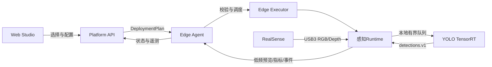

# RealSense→YOLO首条业务链路设计

## 目标

工程师在Web Studio完成以下操作：

1. 从硬件库选择RealSense RGB-D相机；
2. 从算法库选择YOLO目标检测器和模型；
3. 选择已连接的Jetson节点和具体相机实例；
4. 设置分辨率、帧率、置信度和预览参数；
5. 点击部署并运行；
6. 查看检测结果、运行状态、性能和日志。

最终的相机采集和YOLO推理全部在Jetson本地运行。Platform API不转发原始视频，也不参与逐帧推理。

## 领域对象

| 对象 | 含义 | RealSense→YOLO示例 |
| --- | --- | --- |
| `HardwareDefinition` | 硬件产品族和接入契约 | RealSense RGB-D Camera |
| `DeviceInstance` | Edge Agent实际发现的设备 | 型号、序列号、USB速率、可用数据流 |
| `AlgorithmDefinition` | 与硬件无关的算法接口 | Object Detector |
| `ArtifactVariant` | 特定平台可执行制品 | ARM64容器、ONNX模型、TensorRT引擎 |
| `WorkflowDefinition` | 逻辑节点、连接和参数 | Camera.color → Detector.image |
| `DeploymentPlan` | 解析兼容性后的不可变计划 | 节点、镜像摘要、设备权限、模型摘要、配置 |
| `WorkflowRun` | 一次实际运行及状态 | starting/running/degraded/failed/stopped |

硬件库中的“RealSense”不是某个当前在线的USB设备；在线设备是`DeviceInstance`。软件库中的“YOLO”也不是一个模糊名称；它必须关联模型摘要、输入输出契约和适配Jetson的制品版本。

## 控制面与数据面

禁止的数据路径：

- Camera → Platform API → YOLO；
- Camera容器逐帧HTTP传输到YOLO容器；
- 浏览器直接占用RealSense设备；
- 未校验的资产定义直接拼接Shell命令。

## 组件端口契约

### RealSense采集器

输入：

- `device_ref`：具体设备实例；
- `color.width`、`color.height`、`color.fps`；
- 可选深度流配置。

输出：

- `color`：`image.rgb8.v1`；
- `depth`：`image.depth16.v1`；
- `camera_info`：`camera.intrinsics.v1`；
- `health`：帧率、USB错误、重连次数。

### YOLO检测器

输入：

- `image`：接受`image.rgb8.v1`或显式颜色转换后的图像；
- `model`：固定摘要的ONNX或目标设备生成的TensorRT引擎；
- `confidence`、`iou`、类别过滤和输入尺寸。

输出：

- `detections`：`vision.detections.v1`，包含类别、置信度、边界框、时间戳和源帧ID；
- `health`：推理耗时、队列深度、丢帧数、GPU使用情况。

连接规则必须检查像素格式、尺寸策略、时间戳语义和坐标系，不能只检查端口名称。

## 首版运行策略

逻辑上相机和检测器是两个资产，部署时先融合到一个端侧Runtime：

- 使用单进程或同容器插件，避免传输原始帧时的序列化；
- 相机线程和推理线程之间使用容量为1到2的有界队列；
- 队列满时丢弃旧帧并处理最新帧，避免延迟无限累积；
- 推理结果携带源帧时间戳，预览只是可关闭的旁路；
- Runtime异常不会导致Edge Agent退出；
- API断线不会自动停止已经授权的本地工作流。

后续只有在需要跨进程隔离时，才引入共享内存、GStreamer或ROS 2进程间传输。

## RealSense接入策略

RealSense官方说明在Jetson上可选择原生内核后端或RSUSB用户态后端。原生后端更适合生产，但可能涉及L4T内核模块适配；RSUSB便于原型验证，但存在多相机等能力限制。

本项目采用两阶段策略：

1. 原型阶段优先在隔离的Runtime镜像中验证RSUSB，不修改Jetson内核；
2. 生产化阶段根据具体相机型号、固件和L4T 36.5.2实测，再决定是否采用原生后端和受控内核模块方案。

任何内核修改都必须单独评审、备份和安排维护窗口，不能作为“一键部署”的隐式副作用。

## YOLO制品策略

- 训练或下载得到的模型先保存为源模型/ONNX，并记录SHA-256；
- TensorRT引擎与目标GPU、TensorRT和JetPack环境关联，不能当作通用制品；
- 首次部署可以在目标Jetson受控构建引擎并缓存到`/data/robot-platform/cache/tensorrt`；
- 缓存键至少包含模型摘要、GPU型号、计算精度、TensorRT版本和输入尺寸；
- 初期从小型预训练检测模型开始，先验证链路，再更换业务数据模型。

## 部署计划必须包含

- 目标Edge节点和设备实例；
- Runtime镜像的不可变摘要与ARM64架构；
- JetPack/L4T/CUDA/TensorRT兼容范围；
- 模型与配置摘要；
- USB和GPU权限；
- CPU、内存、GPU和磁盘预算；
- 健康检查、启动超时、停止超时与重启策略；
- 结果保留、预览开关和日志级别；
- 失败回滚目标。

## 第一个可度量验收目标

在Jetson AGX Orin、单台RealSense和小型预训练检测模型上：

- 640×480 RGB输入，目标处理速率不低于15 FPS；
- 稳态端到端P95延迟不高于200 ms；
- 持续运行30分钟，无进程崩溃，队列不会无限增长；
- 相机拔出后工作流进入`degraded`，重新接入后可恢复或明确要求重启；
- Platform API短时断开时，本地工作流继续运行并在恢复后补报状态；
- Web Studio显示低频预览、检测框、FPS、P95延迟、丢帧和温度；
- 不产生任何机器人运动控制输出。

这些是第一版工程目标，不是当前已测性能；最终数值以实际相机、模型和功耗模式测试结果为准。

## 实施顺序

1. 定义`HardwareDefinition`、`DeviceInstance`、`AlgorithmDefinition`和端口Schema；
2. Edge Agent实现只读USB/视频设备发现；
3. 用录制视频完成YOLO Jetson推理Runtime；
4. 在取得RealSense后单独完成相机枚举和采集验收；
5. 合并为本地融合工作流并采集性能指标；
6. 实现Platform API资产仓库和兼容性解析；
7. 实现Web Studio选择、配置、部署和运行观察；
8. 完成断线、拔插、回滚和长稳测试。

## 参考资料

- RealSense Jetson安装与后端选择：https://github.com/realsenseai/librealsense/blob/master/doc/installation_jetson.md
- RealSense Linux安装：https://github.com/realsenseai/librealsense/blob/master/doc/installation.md
- Ultralytics Jetson与TensorRT指南：https://docs.ultralytics.com/guides/nvidia-jetson
- NVIDIA JetPack组件说明：https://docs.nvidia.com/jetson/jetpack/6.0/introduction/index.html
- 访问日期：2026-10-02
